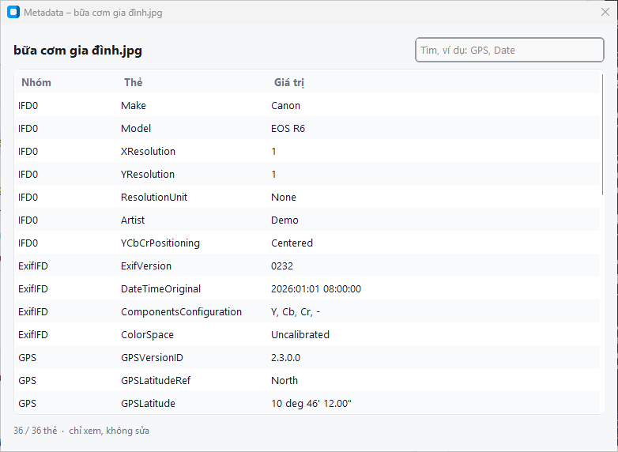

# exif-remover

Strips metadata (EXIF, GPS, XMP, IPTC, comments, C2PA content credentials) from images, video and PDF, like exifremover.com but offline: cleaning runs on your computer and no file is ever uploaded (the Windows app only goes online to check for and download its own updates).

## Hướng dẫn cho Windows (tiếng Việt)

Ứng dụng xoá thông tin ẩn (vị trí GPS, máy chụp, tác giả, phần mềm, ngày chụp, dấu C2PA của ảnh AI...) khỏi ảnh, video và PDF. Việc xoá chạy hoàn toàn trên máy bạn, không tải tệp nào lên mạng.


1. **Tải bộ cài**: mở trang [Releases mới nhất](https://github.com/thientrile/exif-remover/releases/latest), bấm vào tệp `ExifRemover-Setup-x.y.z.exe` (x.y.z là số phiên bản, ví dụ `0.2.0`) để tải về.
2. **Chạy bộ cài**: mở tệp vừa tải. Windows có thể hiện cảnh báo xanh *"Windows protected your PC"* vì bộ cài chưa được ký số: bấm **More info** rồi bấm **Run anyway**.
3. **Cài đặt**: bấm **Next** / **Install** đến khi xong (không cần quyền admin). Sau đó mở ứng dụng từ menu **Start**, tìm **Exif Remover**.
4. **Thêm tệp**: kéo thả ảnh, video, PDF hoặc cả thư mục vào khung trên cùng, hoặc bấm **Chọn tệp** / **Chọn thư mục**. Có thể thêm nhiều lần, danh sách cộng dồn (tệp trùng tự bỏ qua):
   - **Nhiều thư mục cùng lúc**: trong hộp **Chọn thư mục**, giữ **Ctrl** và bấm từng thư mục (hoặc **Shift** để chọn một dãy) rồi bấm **Select Folder**.
   - Hoặc trong File Explorer chọn nhiều thư mục rồi kéo thả cả nhóm vào cửa sổ.
   - Hoặc bấm **Chọn thư mục** nhiều lần, mỗi lần một thư mục.
   - Thư mục sao lưu (`..._backup-NĂM-THÁNG-NGÀY`) luôn bị bỏ qua, kèm cảnh báo. Muốn bỏ tệp nào thì chọn dòng đó rồi bấm **Bỏ tệp đã chọn** (hoặc **Xoá danh sách** để làm lại từ đầu).
5. **Xem metadata (tuỳ chọn)**: chọn một tệp rồi bấm **Xem metadata** (hoặc nhấp đúp) để xem tệp đang chứa thông tin gì; gõ vào ô tìm, ví dụ `GPS` hay `Date`. Chỉ xem, không sửa.
6. **Giữ công tắc "Tạo bản sao lưu trước khi xoá (khuyên dùng)" đang bật** (mặc định đã bật). Trước khi xoá, ứng dụng sao chép nguyên thư mục ra một bản dự phòng bên cạnh.
7. **Bấm Xoá metadata**. Thanh tiến trình chạy, cột **Trạng thái** của từng tệp đổi từ **Chờ** sang **✓ Đã xoá** (hoặc **✗ Lỗi**), cột **Metadata** cho biết số thẻ trước → sau. Tệp được làm sạch ngay tại chỗ (giữ nguyên tên và vị trí).
8. **Xem kết quả** ở thẻ cuối:
   - Thẻ xanh **✓ Đã xoá metadata 5/5 tệp**: tất cả đã sạch và đã được kiểm tra lại.
   - Thẻ đỏ **✗ Đã xoá 4/5 tệp**: có tệp lỗi, tệp đó được giữ nguyên như cũ; bấm **▸ Chi tiết** để xem lý do.
   - Dòng **Bản sao lưu** cho biết thư mục dự phòng, tên dạng `<tên thư mục>_backup-NĂM-THÁNG-NGÀY` (ví dụ chọn `C:\demo\photos` thì là `C:\demo\photos_backup-2026-11-15`). Bấm **Mở thư mục sao lưu** để mở. Kiểm tra ảnh đã ổn thì có thể xoá thư mục dự phòng này cho nhẹ máy.
9. **Cập nhật**: khi có bản mới, ứng dụng hỏi **Có bản mới vX.Y.Z** kèm ghi chú. Bấm **Cập nhật ngay** thì ứng dụng tải bộ cài từ trang GitHub này, kiểm tra mã SHA256, cài đè rồi tự mở lại; bấm **Để sau** để bỏ qua. Không bao giờ tự cài khi bạn chưa bấm. Có thể tắt **Tự kiểm tra cập nhật khi mở** hoặc bấm **Kiểm tra cập nhật** ở góc dưới.
10. **Gỡ cài đặt**: **Settings** → **Apps** → **Installed apps**, tìm **Exif Remover**, bấm **...** → **Uninstall**. Các tệp đã làm sạch và bản sao lưu không bị xoá.

Lưu ý: chỉ thư mục (thêm bằng kéo thả hoặc **Chọn thư mục**) mới được sao lưu; tệp lẻ thì không. Mạng chỉ được dùng để kiểm tra và tải bản cập nhật từ GitHub; tệp của bạn không bao giờ được gửi đi.

<details><summary>Cửa sổ Xem metadata</summary>



</details>

## Windows app (English)

1. Download `ExifRemover-Setup-<version>.exe` from [Releases](https://github.com/thientrile/exif-remover/releases/latest) and run it. It installs for your user only (no admin) and adds a Start menu entry; uninstall from Settings → Apps.
2. The installer is not code-signed, so Windows SmartScreen will warn "Windows protected your PC": click **More info** → **Run anyway**.
3. Drop files or folders on the window (or **Chọn tệp** / **Chọn thư mục**, which takes several folders with Ctrl/Shift; every pick adds to the list), keep **Tạo bản sao lưu trước khi xoá** on, press **Xoá metadata**. Each row shows its status and tag count before → after; the result card shows the backup folder. **Xem metadata** shows a file's tags (read-only, searchable). exiftool, ffmpeg and qpdf are bundled.
4. **Updates**: the app checks GitHub Releases on start (can be turned off). When you click **Cập nhật ngay** it downloads the new installer from this repository's release, verifies it against the release's `SHA256SUMS.txt`, installs it silently for your user and restarts. **Network use**: only that update check and download; cleaning is fully offline and your files are never uploaded. The request sends only a generic `ExifRemover/<version>` user agent.

## CLI (Linux / WSL)

Needs `exiftool`, `ffmpeg` and `qpdf` (`sudo apt install libimage-exiftool-perl ffmpeg qpdf`). Python 3 stdlib only.

```sh
exif-remover "C:\path\to\folder"      # backup + clean + verify + summary (WSL maps C:\ to /mnt/c)
exif-remover --no-backup PHOTO.jpg ~/videos
python3 -m unittest discover -s tests   # tests
```

Install (no sudo): `chmod +x exif_remover.py && ln -s "$PWD/exif_remover.py" ~/.local/bin/exif-remover`.
The Windows app takes the same arguments: `ExifRemover.exe --no-backup C:\photos` runs without a window (exit code 0 = OK).

## What it does

- **Backup first**: each folder given is copied to a sibling `<folder>_backup-YYYY-MM-DD` (`-2`, `-3`… if it exists). If the file count does not match, it stops before cleaning anything. Folders named `*_backup-*` are skipped while scanning. Single files are not backed up; `--no-backup` (or unticking **Make backup**) turns backups off.
- **Cleans in place**: same folder, same filename. Each file is written to a hidden temp file next to it, re-checked with `exiftool`, and only then swapped over the original. If cleaning or the check fails, the original is left untouched, the file is listed as `FAIL`, and the exit code is 1.
- The last line is `OK: N cleaned, 0 failed, 0 skipped. Backup: ...` or `FAILED: ...`.
- Formats: JPEG, PNG, WebP, HEIC, AVIF, GIF, TIFF (`exiftool -all=`, orientation and ICC colour profile kept), MP4/MOV (`ffmpeg -map_metadata -1 -c copy`, no re-encode; data/telemetry tracks dropped), PDF (`exiftool -all:all=` then a full `qpdf` rewrite so the old metadata can't be recovered).
- Removes EXIF, GPS, XMP, IPTC, comments, thumbnails and C2PA/JUMBF content credentials (e.g. the ChatGPT `caBX` chunk in PNGs).
- Kept on purpose: orientation and the ICC colour profile (needed for correct colours; it holds only a profile name and copyright, no personal data), like exifremover.com.
- Not removable this way: invisible watermarks embedded in the pixels themselves (C2PA `c2pa.watermarked`, SynthID-style marks).

## Building

GitHub Actions (`.github/workflows/build.yml`, `windows-latest`) downloads pinned, SHA256-checked builds of the tools (`scripts/fetch_tools.py`), runs the tests on Windows, packages with PyInstaller and builds the installer with Inno Setup (`installer.iss`), installs it and smoke-tests it. A `v*` tag publishes the installer to Releases.

## License

MIT (`LICENSE`). The bundled tools keep their own licenses: see `THIRD_PARTY_NOTICES.md`.
