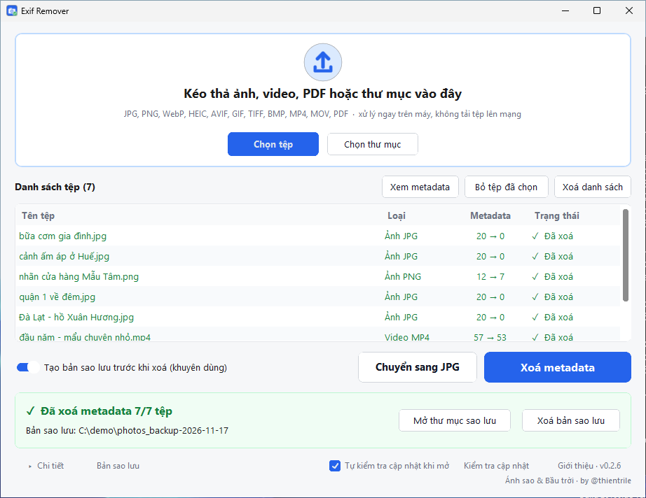

# Tinh Ảnh (StarVeil)

**Xoá metadata ảnh · Photo Metadata Remover.** Tên cũ / formerly: Exif Remover.

Strips metadata (EXIF, GPS, XMP, IPTC, comments, C2PA content credentials) from images, video and PDF, offline: cleaning runs on your computer and no file is ever uploaded (the GitHub build only goes online to check for and download its own updates; the Microsoft Store build never goes online).

Chính sách / Policies: [Quyền riêng tư / Privacy](https://thientrile.github.io/exif-remover/PRIVACY.html) · [Điều khoản / Terms](https://thientrile.github.io/exif-remover/TERMS.html) · [Lưu ý / Disclaimer](https://thientrile.github.io/exif-remover/DISCLAIMER.html) · [Hỗ trợ / Support](https://thientrile.github.io/exif-remover/SUPPORT.html)

## Hướng dẫn cho Windows (tiếng Việt)

Ứng dụng xoá thông tin ẩn (vị trí GPS, máy chụp, tác giả, phần mềm, ngày chụp, dấu C2PA của ảnh AI...) khỏi ảnh, video và PDF. Việc xoá chạy hoàn toàn trên máy bạn, không tải tệp nào lên mạng.



1. **Tải bộ cài**: mở trang [Releases mới nhất](https://github.com/thientrile/exif-remover/releases/latest), bấm vào tệp `StarVeil-Setup-x.y.z.exe` (x.y.z là số phiên bản, ví dụ `1.0.0`) để tải về. (Tệp `ExifRemover-Setup-x.y.z.exe` là cùng bộ cài đó dưới tên cũ, để bản cũ tự cập nhật được; tệp `.msix` dành cho Microsoft Store, không dùng để cài trực tiếp.)
2. **Chạy bộ cài**: mở tệp vừa tải. Windows có thể hiện cảnh báo xanh *"Windows protected your PC"* vì bộ cài chưa được ký số: bấm **More info** rồi bấm **Run anyway**.
3. **Cài đặt**: bấm **Next** / **Install** đến khi xong (không cần quyền admin). Sau đó mở ứng dụng từ menu **Start**, tìm **Tinh Ảnh** (hoặc **StarVeil**). Nếu máy đã có Exif Remover bản cũ, bộ cài nâng cấp đè lên bản đó, giữ nguyên cài đặt và danh sách bản sao lưu.
4. **Thêm tệp**: kéo thả ảnh, video, PDF hoặc cả thư mục vào khung trên cùng, hoặc bấm **Chọn tệp** / **Chọn thư mục**. Có thể thêm nhiều lần, danh sách cộng dồn (tệp trùng tự bỏ qua):
   - **Nhiều thư mục cùng lúc**: trong hộp **Chọn thư mục**, giữ **Ctrl** và bấm từng thư mục (hoặc **Shift** để chọn một dãy) rồi bấm **Select Folder**.
   - Hoặc trong File Explorer chọn nhiều thư mục rồi kéo thả cả nhóm vào cửa sổ.
   - Hoặc bấm **Chọn thư mục** nhiều lần, mỗi lần một thư mục.
   - Thư mục sao lưu (`..._backup-NĂM-THÁNG-NGÀY`) luôn bị bỏ qua, kèm cảnh báo. Muốn bỏ tệp nào thì chọn dòng đó rồi bấm **Bỏ tệp đã chọn** (hoặc **Xoá danh sách** để làm lại từ đầu).
5. **Xem metadata (tuỳ chọn)**: chọn một tệp rồi bấm **Xem metadata** (hoặc nhấp đúp) để xem tệp đang chứa thông tin gì; gõ vào ô tìm, ví dụ `GPS` hay `Date`. Chỉ xem, không sửa.
6. **Giữ công tắc "Tạo bản sao lưu trước khi xoá (khuyên dùng)" đang bật** (mặc định đã bật). Trước khi xoá, ứng dụng sao chép nguyên thư mục ra một bản dự phòng bên cạnh.
7. **Bấm Xoá metadata**. Thanh tiến trình chạy, cột **Trạng thái** của từng tệp đổi từ **Chờ** sang **✓ Đã xoá** (hoặc **✗ Lỗi**), cột **Metadata** cho biết số thẻ trước → sau. Tệp được làm sạch ngay tại chỗ (giữ nguyên tên và vị trí).
8. **Xem kết quả** ở thẻ cuối:
   - Thẻ xanh **✓ Đã xoá metadata 5/5 tệp**: tất cả đã sạch và đã được kiểm tra lại.
   - Thẻ đỏ **✗ Đã xoá 4/5 tệp**: có tệp lỗi, tệp đó được giữ nguyên như cũ; bấm **▸ Chi tiết** để xem lý do.
   - Dòng **Bản sao lưu** cho biết thư mục dự phòng, tên dạng `<tên thư mục>_backup-NĂM-THÁNG-NGÀY` (ví dụ chọn `C:\demo\photos` thì là `C:\demo\photos_backup-2026-11-15`). Bấm **Mở thư mục sao lưu** để mở.
   - Kiểm tra ảnh đã ổn thì bấm **Xoá bản sao lưu** để chuyển thư mục dự phòng vào **Thùng rác** (Recycle Bin, khôi phục được). Ứng dụng hỏi lại, kèm đường dẫn, số tệp và dung lượng. Nút này chỉ bấm được khi mọi tệp đều xoá thành công; nếu có tệp lỗi hay đã bấm **Dừng** thì bản sao lưu là bản tốt duy nhất nên được giữ lại.
9. **Dọn bản sao lưu cũ**: bấm **Bản sao lưu** ở góc dưới bên trái. Cửa sổ liệt kê các bản sao lưu do chính ứng dụng tạo: thư mục, ngày tạo, dung lượng, thư mục gốc còn hay không. Chọn một hoặc nhiều dòng (giữ Ctrl), hoặc bấm **Chọn tất cả**, rồi bấm **Xoá** (vào Thùng rác, có hỏi lại).
   - Ứng dụng chỉ xoá thư mục nó tự tạo và còn đúng tên `..._backup-NĂM-THÁNG-NGÀY`; thư mục khác không bao giờ bị đụng tới. Bản sao lưu đã bị xoá hoặc đổi tên bằng tay sẽ tự biến khỏi danh sách.
   - Tuỳ chọn **Khi mở ứng dụng, đề nghị xoá bản sao lưu cũ hơn N ngày** (mặc định tắt): bật lên thì mỗi lần mở, nếu có bản cũ hơn N ngày, ứng dụng hỏi trước khi xoá, không bao giờ tự xoá âm thầm.
10. **Chuyển ảnh sang JPG** (chạy trên máy, không tải ảnh lên mạng): thêm ảnh WebP, PNG, GIF, BMP, TIFF, AVIF hoặc HEIC vào danh sách rồi bấm **Chuyển sang JPG**.
    - Mỗi ảnh có thêm một tệp `.jpg` mới **nằm cạnh ảnh gốc**, cùng tên (ví dụ `anh.webp` → `anh.jpg`). Nếu `anh.jpg` đã có thì tạo `anh-1.jpg`, `anh-2.jpg`... Ảnh gốc **giữ nguyên**, không bị sửa hay xoá, nên không cần sao lưu.
    - Ảnh JPG mới **không có metadata** (như khi bấm Xoá metadata), nhưng vẫn đúng chiều xoay và đúng màu (giữ hồ sơ màu RGB).
    - Phần trong suốt (PNG, WebP, GIF) được tô nền **trắng**. Ảnh động (GIF, WebP) chỉ lấy **khung hình đầu tiên**; cột Trạng thái ghi "(khung đầu)".
    - Tệp đã là JPEG (kể cả JPEG bị đặt đuôi .png) và video, PDF được **bỏ qua** ("– Bỏ qua"). Rê chuột lên một dòng để xem tên tệp JPG vừa tạo hoặc lý do bỏ qua. Bấm **Dừng** để dừng sau ảnh hiện tại. Thẻ kết quả có nút **Mở thư mục**.
11. **Cập nhật**: khi có bản mới, ứng dụng hỏi **Có bản mới vX.Y.Z** kèm ghi chú. Bấm **Cập nhật ngay** thì ứng dụng tải bộ cài từ trang GitHub này, kiểm tra mã SHA256, cài đè rồi tự mở lại; bấm **Để sau** để bỏ qua. Không bao giờ tự cài khi bạn chưa bấm. Có thể tắt **Tự kiểm tra cập nhật khi mở** hoặc bấm **Kiểm tra cập nhật** ở góc dưới.
12. **Gỡ cài đặt**: **Settings** → **Apps** → **Installed apps**, tìm **Tinh Ảnh (StarVeil)**, bấm **...** → **Uninstall**. Các tệp đã làm sạch và bản sao lưu không bị xoá.

13. **Giới thiệu, báo lỗi**: bấm **Giới thiệu · vX.Y.Z** ở góc dưới bên phải để xem phiên bản, giấy phép và các công cụ đi kèm, mở trang dự án, **Báo lỗi / góp ý** hay **Mở thư mục log**. Khi gặp lỗi, ứng dụng ghi vào `%LOCALAPPDATA%\ExifRemover\logs\app.log` (chỉ đường dẫn và nội dung lỗi, không ghi nội dung ảnh hay giá trị metadata) và hiện hộp thoại có nút **Mở thư mục log** và **Báo lỗi**. Khi báo lỗi, dán vài dòng cuối của tệp log vào.

### Bản Microsoft Store

Bản Microsoft Store (đang chuẩn bị) là cùng ứng dụng, đóng gói MSIX. Store tự cập nhật nên bản này không có nút **Kiểm tra cập nhật** và không kết nối mạng. Mỗi máy chỉ nên cài một trong hai bản (GitHub hoặc Store). Với bản Store, Windows lưu `settings.json`, `backups.json` và log trong vùng riêng của ứng dụng (`%LOCALAPPDATA%\Packages\...`) và xoá chúng khi gỡ; thư mục sao lưu cạnh thư mục ảnh của bạn thì vẫn còn. Dòng lệnh: `starveil.exe` hoặc `exif-remover.exe`.

### Quyền riêng tư

Mọi xử lý diễn ra trên máy bạn; ứng dụng không tải ảnh lên đâu. Chỉ kết nối GitHub để kiểm tra và tải bản cập nhật (có thể tắt). Không có quảng cáo, không thu thập dữ liệu sử dụng. Tệp log chỉ nằm trên máy bạn. Thư mục `%APPDATA%\ExifRemover` và `%LOCALAPPDATA%\ExifRemover` giữ tên cũ để không mất dữ liệu khi nâng cấp. Chi tiết: [Chính sách quyền riêng tư](https://thientrile.github.io/exif-remover/PRIVACY.html).

### Cảnh báo SmartScreen

Bộ cài chưa được ký số (code signing), nên lần đầu chạy Windows có thể hiện *"Windows protected your PC"*. Đây là cảnh báo cho mọi phần mềm chưa ký, không phải virus. Bấm **More info** rồi **Run anyway**. Muốn chắc chắn tệp đúng là bản phát hành, so mã SHA256 của tệp (`Get-FileHash StarVeil-Setup-x.y.z.exe`) với tệp `SHA256SUMS.txt` trên trang Releases.

Lưu ý: chỉ thư mục (thêm bằng kéo thả hoặc **Chọn thư mục**) mới được sao lưu; tệp lẻ thì không. Mạng chỉ được dùng để kiểm tra và tải bản cập nhật từ GitHub; tệp của bạn không bao giờ được gửi đi.

<details><summary>Cửa sổ Xem metadata</summary>


</details>

## Windows app (English)

1. Download `StarVeil-Setup-<version>.exe` from [Releases](https://github.com/thientrile/exif-remover/releases/latest) and run it. It installs for your user only (no admin) and adds a Start menu entry; uninstall from Settings → Apps.
2. The installer is not code-signed, so Windows SmartScreen will warn "Windows protected your PC": click **More info** → **Run anyway**.
3. Drop files or folders on the window (or **Chọn tệp** / **Chọn thư mục**, which takes several folders with Ctrl/Shift; every pick adds to the list), keep **Tạo bản sao lưu trước khi xoá** on, press **Xoá metadata**. Each row shows its status and tag count before → after; the result card shows the backup folder and, after a fully successful run, **Xoá bản sao lưu** (to the Recycle Bin). The **Bản sao lưu** footer button lists the backups the app made (recorded in `%APPDATA%\ExifRemover\backups.json`) to delete them. **Xem metadata** shows a file's tags (read-only, searchable). **Chuyển sang JPG** writes a new metadata-free `name.jpg` (or `name-1.jpg`…) next to each WebP/PNG/GIF/BMP/TIFF/AVIF/HEIC image, offline; originals are untouched, JPEGs are skipped. exiftool, ffmpeg and qpdf are bundled.
4. **Updates**: the app checks GitHub Releases on start (can be turned off). When you click **Cập nhật ngay** it downloads the new installer from this repository's release, verifies it against the release's `SHA256SUMS.txt`, installs it silently for your user and restarts. **Network use**: only that update check and download; cleaning is fully offline and your files are never uploaded. The request sends only a generic `StarVeil/<version>` user agent. The Microsoft Store build has no updater and makes no network requests.

## CLI (Linux / WSL)

Needs `exiftool`, `ffmpeg` and `qpdf` (`sudo apt install libimage-exiftool-perl ffmpeg qpdf`). Python 3 stdlib only.

```sh
exif-remover "C:\path\to\folder"      # backup + clean + verify + summary (WSL maps C:\ to /mnt/c)
exif-remover --no-backup PHOTO.jpg ~/videos
exif-remover --to-jpg ~/Downloads/webp   # new metadata-free name.jpg next to each image, originals untouched
python3 -m unittest discover -s tests   # tests
```

Install (no sudo): `chmod +x exif_remover.py && ln -s "$PWD/exif_remover.py" ~/.local/bin/exif-remover`.
The Windows app takes the same arguments: `StarVeil.exe --no-backup C:\photos` (Store build: `starveil.exe` or `exif-remover.exe`) runs without a window (exit code 0 = OK).

## What it does

- **Backup first**: each folder given is copied to a sibling `<folder>_backup-YYYY-MM-DD` (`-2`, `-3`… if it exists). If the file count does not match, it stops before cleaning anything. Folders named `*_backup-*` are skipped while scanning. Single files are not backed up; `--no-backup` (or unticking **Make backup**) turns backups off.
- **Cleans in place**: same folder, same filename. Each file is written to a hidden temp file next to it, re-checked with `exiftool`, and only then swapped over the original. If cleaning or the check fails, the original is left untouched, the file is listed as `FAIL`, and the exit code is 1.
- The last line is `OK: N cleaned, 0 failed, 0 skipped. Backup: ...` or `FAILED: ...`.
- Formats: JPEG, PNG, WebP, HEIC, AVIF, GIF, TIFF (`exiftool -all=`, orientation and ICC colour profile kept), MP4/MOV (`ffmpeg -map_metadata -1 -c copy`, no re-encode; data/telemetry tracks dropped), PDF (`exiftool -all:all=` then a full `qpdf` rewrite so the old metadata can't be recovered).
- Removes EXIF, GPS, XMP, IPTC, comments, thumbnails and C2PA/JUMBF content credentials (e.g. the ChatGPT `caBX` chunk in PNGs).
- Kept on purpose: orientation and the ICC colour profile (needed for correct colours; it holds only a profile name and copyright, no personal data).
- **To JPG** (`--to-jpg`, GUI **Chuyển sang JPG**): WebP, PNG, GIF, BMP, TIFF, AVIF, HEIC → a new `name.jpg` beside the original (`name-1.jpg`… if taken; the name is reserved with an exclusive create, so nothing is ever overwritten). ffmpeg decodes and encodes (high quality, `-q:v 2`, 4:2:0); EXIF orientation is applied to the pixels, transparency is flattened onto white, animations give their first frame (animated WebP via a small first-frame extractor, since ffmpeg cannot decode those). Then `exiftool -all=` keeps only an RGB ICC profile, the result is verified like a cleaned file and renamed into place. Files that are really JPEG are skipped. Limits: HEIC alpha is not applied (transparent HEIC areas are not white); AVIF/HEIC colour given only as nclx (no ICC) is treated as sRGB.
- Not removable this way: invisible watermarks embedded in the pixels themselves (C2PA `c2pa.watermarked`, SynthID-style marks).

## Building

GitHub Actions (`.github/workflows/build.yml`, `windows-latest`) downloads pinned, SHA256-checked builds of the tools (`scripts/fetch_tools.py`), runs the tests on Windows, packages with PyInstaller and builds the installer with Inno Setup (`installer.iss`), installs it and smoke-tests it. It also builds the Microsoft Store package (`scripts/msix.py`, `packaging/AppxManifest.xml`, `makeappx`), installs a test-signed copy and cleans a file through it. A `v*` tag publishes `StarVeil-Setup-<v>.exe`, the same file as `ExifRemover-Setup-<v>.exe` (for v0.2.x updaters), the unsigned `.msix` and `SHA256SUMS.txt` to Releases, then checks that the previous release updates itself to the new one. Store submission kit: `docs/store/`.

## License

MIT (`LICENSE`). The bundled tools keep their own licenses: see `THIRD_PARTY_NOTICES.md`.

---

Ánh sao & Bầu trời · by [@thientrile](https://github.com/thientrile)
